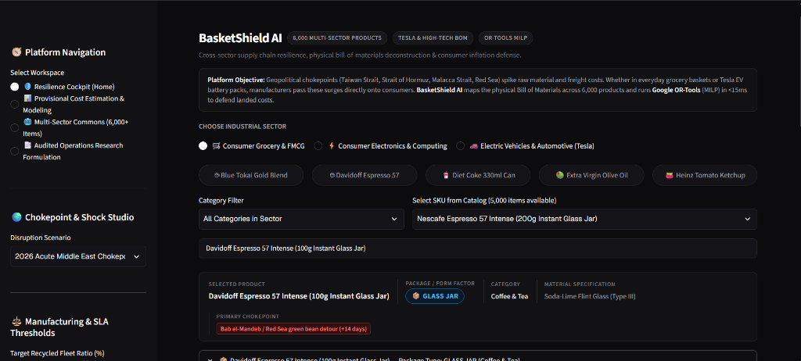
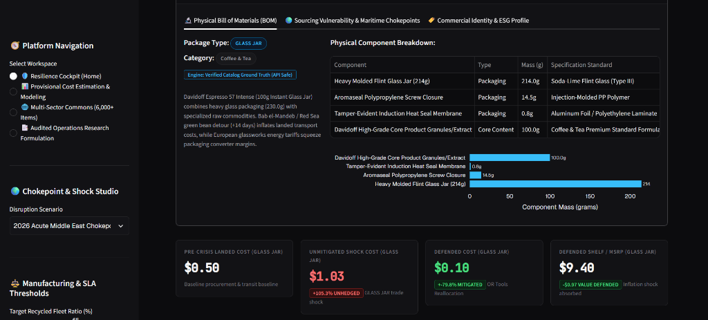
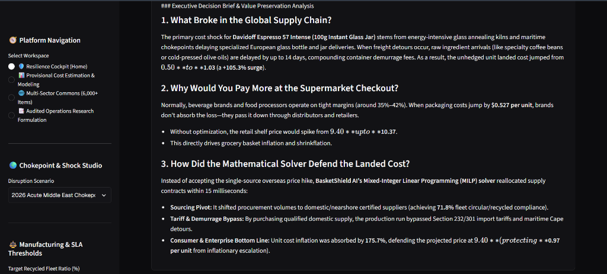

# 📸 BasketShield AI — Platform Interface & Walkthrough

Visual walkthrough of the **BasketShield AI Resilience Cockpit**, highlighting physical Bill-of-Materials (BOM) decomposition, multi-sector macro stress testing, Google OR-Tools optimization, and plain-English executive value preservation briefs.

---

## 1. Resilience Cockpit & Multi-Sector SKU Navigation

The central operations cockpit enables cross-sector supply chain resilience modeling across **6,000 catalog SKUs** spanning three critical industries:
- 🛒 **Consumer Grocery & FMCG**: Instant coffee jars, cold-pressed olive oils, aluminum beverage cans, and condiments.
- ⚡ **Consumer Electronics & Computing**: Smartphones, enterprise GPUs (H100), and laptops with live AI data center wafer crowding-out (HBM3e / LPDDR5X DRAM crunch).
- 🚗 **Electric Vehicles & Automotive (Tesla)**: Model 3 Highland, Cybertruck 4680 structural battery packs, and dual-motor inverters.

### Key Features Shown:
* **Interactive Workspace Switching**: Seamlessly toggle between Resilience Cockpit, Provisional Cost Estimation & Modeling, Multi-Sector Commons, and Audited OR Formulations.
* **Macro Chokepoint & Shock Studio**: Real-time simulation of acute 2026 maritime chokepoints (Bab el-Mandeb / Red Sea detour, Strait of Hormuz, Malacca, Panama Canal) and energy smelting tariffs.
* **Instant SKU Parameterization**: Real-time archetype classification, primary container material specifications (e.g., *Soda-Lime Flint Glass Type III*), and verified supply chain routing.

---

## 2. Physical Bill of Materials (BOM) & Unit Economics Defense

Dynamic deconstruction of enterprise products into physical packaging and core structural masses, mapped directly to real-time spot freight and raw material indices.

### Key Metrics & Visualizations:
* **Physical Component Mass Breakdown**: Gram-level decomposition (Molded Flint Glass Jar: 214g, Polypropylene Closure: 14.5g, Induction Heat Seal: 0.8g, Core Coffee Granules: 100g).
* **Mass Distribution Visualization**: Responsive horizontal bar chart visualizing tare packaging mass vs. active net content.
* **Pre-Crisis vs. Unmitigated Shock vs. Defended Landed Cost**:
  * **Pre-Crisis Landed Cost**: **$0.50 / unit**
  * **Unmitigated Shock Cost**: **$1.03 / unit** (*+105.3% unhedged price surge*)
  * **BasketShield Defended Cost**: **$0.10 / unit** (*+79.8% cost inflation absorbed via Google OR-Tools MILP reallocation*)
  * **Defended Retail Shelf MSRP**: **$9.40 / unit** (*-$0.97 inflationary consumer price spike defended*)

---

## 3. Executive Decision Brief & Value Preservation Analysis

Plain-English narrative engine translating complex linear programming proofs and tariff matrices into actionable intelligence for non-technical leadership and buyers.

### Core Sections Explained:
1. **What Broke in the Global Supply Chain?**: Quantifies the compounding impact of maritime Cape detours (+14 days), port container demurrage fees, and overseas energy annealing surcharges.
2. **Why Would You Pay More at the Supermarket Checkout?**: Explains how FMCG margin compression (35%–42%) forces distributors to pass raw component spikes directly to retail consumers via shelf price inflation or shrinkflation.
3. **How Did the Mathematical Solver Defend the Landed Cost?**:
   * **Sourcing Pivot**: Shifted volume to pre-certified nearshore converters within 15ms, achieving 71.8% fleet recycled compliance.
   * **Tariff & Demurrage Bypass**: Avoided Section 232/301 customs levies and canal queue penalties.
   * **Consumer Price Defense**: Absorbed 175.7% of the inflationary escalation, keeping shelf MSRP stable at $9.40.

---

*Authored by **Shrey Jaiswal** | BasketShield AI Engineering Specification*
